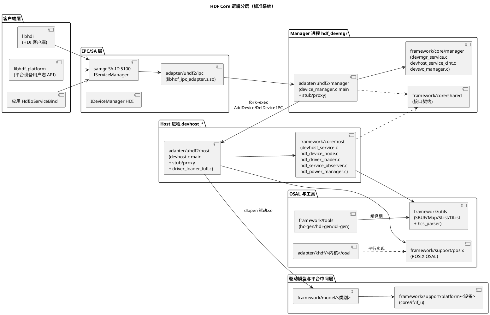

# 架构设计及约束

## 架构设计

### 设计原则

| 原则 | 描述 | 理由 |
|---|---|---|
| Manager-Host 多进程隔离 | `hdf_devmgr` 管理生命周期，`devhost_*` 孵化驱动；每个 hostId 独立进程 | 单个驱动崩溃不影响 Manager 或其它 Host；进程边界提供权限隔离与 SELinux 粒度 |
| 契约-实现分离 | `framework/core/shared/` 仅定义接口契约（虚表 + 头文件），不承载业务 | 框架层（`framework/core/manager`、`framework/core/host`）与适配层（`adapter/uhdf2/manager`、`adapter/uhdf2/host`）双侧实现同一契约，便于跨系统形态复用 |
| 框架-适配-内核三分 | `framework/` 不含内核特定代码；内核适配进 `adapter/khdf/<内核>/`；用户态适配进 `adapter/uhdf2/`（standard）或 `adapter/uhdf/`（small） | 一次框架开发，多内核/多形态部署；避免 `<linux/*.h>` 污染框架 |
| 驱动模型归一化 | 每类硬件（audio/camera/display/input/...）有独立 `framework/model/<类别>/` 框架 | 外设驱动在统一框架内实现，避免散落到 core/support |
| 平台设备三层结构 | 平台外设分 `xxx_core.c`（核心抽象）/ `xxx_if.c`（内核态 API）/ `xxx_if_u.c`（用户态 API） | 内核态直接调 core；用户态经 `HdfIoService` + SBUF；同一 core 实现服务两种调用环境 |
| HCS 配置驱动 | 设备树由 `.hcs` 文本经 `hc-gen` 编译为 `.hcb`，运行时 `device_resource_if` 解析 | 配置与代码解耦；支持编译期校验与运行时高效解析 |
| HDI 代码生成 | HDI 接口由 `hdi-gen` 从 IDL 自动生成 proxy/stub/service/driver | 避免手写 IPC 样板代码；保证契约一致性 |
| 错误码分段只增不复用 | `HDF_STATUS`（`interfaces/inner_api/utils/hdf_base.h:42-77`）分通用/BSP(-100 段)/设备(-200 段) | 向后兼容，新增错误码不破坏旧调用方 |
| OSAL 按内核分目录 | Linux/LiteOS-A/LiteOS-M/UniProton/HongMeng 各有 `adapter/khdf/<内核>/osal/`；用户态 POSIX 在 `framework/support/posix/` 与 `adapter/uhdf/posix/` | 同一 OSAL 接口在不同内核有独立实现，不互相污染 |

### 逻辑架构

HDF Core 自上而下、自外而内可分为六层（标准系统视角）：

各层职责与核心源码位置：

1. **客户端层**：应用/系统服务经 `HdfIoServiceBind(serviceName)` 或 HDI 代理获取服务句柄；平台设备用户态 API（`xxx_if_u.c`）封装 SBUF 序列化细节。
2. **IPC/SA 层**：`adapter/uhdf2/ipc/` 把 C 框架对接到 OHOS C++ IPC（`HdfRemoteService`、`HdfRemoteDispatcher`），仅做桥接不写业务；`samgr` 注册 SA-ID 5100。
3. **Manager 进程**：`framework/core/manager/`（框架）+ `adapter/uhdf2/manager/`（适配）。入口 `adapter/uhdf2/manager/device_manager.c`。负责 host 启动、设备生命周期、服务注册表、uevent、电源传播。
4. **Host 进程**：`framework/core/host/`（框架）+ `adapter/uhdf2/host/`（适配）。入口 `adapter/uhdf2/host/devhost.c`（但本仓不构建，由 `drivers/peripheral/devhost/host/BUILD.gn` 链接 `libhdf_host`）。负责 dlopen 驱动、Bind/Init/Release、发布服务、本地观察订阅、电源 token。
5. **驱动模型与平台中间层**：`framework/model/<类别>/` 为每类硬件提供归一化框架；`framework/support/platform/<设备>/` 分 core/if/if_u 三层。
6. **OSAL 与工具**：`framework/utils/` 提供 SBUF、Map、SList、DList 与 hcs_parser；`framework/support/posix/` + `adapter/uhdf/posix/` 提供 POSIX OSAL；`adapter/khdf/<内核>/osal/` 提供各内核 OSAL；`framework/tools/` 提供 hc-gen/hdi-gen/idl-gen。

**对象工厂与虚表模型**：核心对象（`HDF_OBJECT_ID_DEVMGR_SERVICE` 等 8 类，见 `framework/core/shared/include/hdf_object_manager.h:18-29`）通过 `HdfObjectManagerGetCreators(objectId)` 查 Creator 表创建。不同进程环境（kernel/uhdf2/uhdf）注册不同 Creator 表，使同一框架代码在不同环境实例化不同实现（如 Host 进程中 `DEVMGR_SERVICE` 创建 `DevmgrServiceProxy`，Manager 进程中创建 `DevmgrServiceStub`）。

### 非功能设计

| 场景类别 | 方案设计 |
|---|---|
| 进程隔离与故障收敛 | devhost 设置 `PR_SET_PDEATHSIG(SIGKILL)`，Manager 死亡时自动退出；servmgr 死亡时 `_exit(0)`；Host 死亡由 Manager 异步 `MessageTask` 清理（`CleanupDiedHostResources`），避免 Binder 回调死锁 |
| Manager-Host IPC 死锁规避 | AddDevice/DelDevice 经 devhost `MessageTask` 异步处理（`adapter/uhdf2/host/src/devhost_service_stub.c:90` 持 `hostSvcMutex`）；AttachDeviceHost 重试 100 次 × 20ms |
| 服务 IO 并发安全 | `DeviceServiceStubDispatch` 在 `pthread_rwlock_rdlock`（读锁）保护下调用驱动 `Dispatch`；`Release` 在写锁下置空 `service`（`adapter/uhdf2/host/src/device_service_stub.c:37-57`） |
| Manager hosts 列表并发 | `g_hostsLock`（`pthread_rwlock_t`，`framework/core/manager/src/devmgr_service.c:28`）保护 hosts DList 的读写 |
| 配置解析性能 | `.hcs` 编译为 `.hcb` 二进制，运行时 `GenerateCfgTree` 直接构造树，避免文本解析开销 |
| 驱动加载隔离 | `dlopen_ns` 使用 namespace 隔离驱动 .so 符号；VDI 加载前 `realpath` 校验路径必须位于 `HDF_LIBRARY_DIR` 下（防路径穿越） |
| 电源状态一致性 | 唤醒反向遍历 hosts（后设备先醒），休眠正向遍历（先设备先睡）；单个设备失败不阻断其它设备（`devhost_service.c:172` 注释明确策略） |
| 跨内核可移植 | OSAL 接口统一于 `interfaces/inner_api/osal/shared/`，实现按内核分散；框架代码不含内核头文件 |
| 错误码兼容 | `HDF_STATUS` 分段（通用 0/-1~-20、BSP -100 段、设备 -200 段），只新增不复用（`interfaces/inner_api/utils/hdf_base.h:42-77`） |

## 架构约束

- **框架不含内核特定代码**
  - **what**：`framework/` 目录下禁止引入 `<linux/*.h>` 等内核头文件或内核专属 API；内核适配一律进 `adapter/khdf/<内核>/`。
  - **why**：框架需跨 5 个内核 + 用户态 POSIX 复用，引入内核依赖会破坏可移植性并污染其它内核构建。

- **Manager-Host 双侧同步修改**
  - **what**：Manager 代码分布在 `framework/core/manager/` + `adapter/uhdf2/manager/`；Host 分布在 `framework/core/host/` + `adapter/uhdf2/host/`；新增交互先在 `framework/core/shared/include/` 定义契约。
  - **why**：单侧修改会导致框架与适配不一致，Manager-Host IPC 握手失败或设备状态漂移。

- **uhdf 与 uhdf2 不交叉混改**
  - **what**：`adapter/uhdf/`（small 系统）与 `adapter/uhdf2/`（standard 系统）代码不共用，各自平行维护。
  - **why**：两套适配层面向不同系统形态（进程模型、IPC 能力、libc 差异），混改会引入不可见依赖导致 small 系统编译或运行失败。

- **IPC 桥接层不承载业务**
  - **what**：`adapter/uhdf2/ipc/` 只做 C 框架到 OHOS C++ IPC 的桥接，不写 HDF 业务逻辑。
  - **why**：业务逻辑进 IPC 层会破坏框架-适配分层，导致 small/mini 系统无法复用框架。

- **HDI 生成物不可手改**
  - **what**：`hdi-gen`/`idl-gen` 生成的 proxy/stub/service/driver 代码不可手工修改；改 IDL 后重新执行工具。
  - **why**：手改生成物会在下次工具执行时被覆盖，且无法保证契约一致性。

- **公开 API 签名/错误码只增不改**
  - **what**：`framework/include/**`、`interfaces/inner_api/**` 中已发布函数不得删除或修改签名/参数语义/错误码；错误码只能新增且落在已划定段。
  - **why**：下游仓（`drivers/interface`、`drivers/peripheral`、`vendor/**`）依赖这些 header，破坏性变更会阻塞全链路编译。

- **SBUF 类型与 wire-format 稳定**
  - **what**：`enum HdfSbufType`（`interfaces/inner_api/utils/hdf_sbuf.h:50-55`）4 成员语义固定：`SBUF_RAW`（用户-内核直通）、`SBUF_IPC`（进程间 IPC）、`SBUF_IPC_HW`（保留位）、`SBUF_TYPE_MAX`（sentinel）；修改需走架构评审。
  - **why**：SBUF 是 Manager-Host、客户端-驱动的核心序列化机制，wire-format 变更影响跨版本与内核/用户态一致性。

- **`adapter/platform/` 不进产品链**
  - **what**：`adapter/platform/` 仅作 SoC 板级平台驱动 vendor 参考实现，不作为产品编译依赖。
  - **why**：正式产品由 vendor 自维护，框架代码不应直接调用厂商适配。
