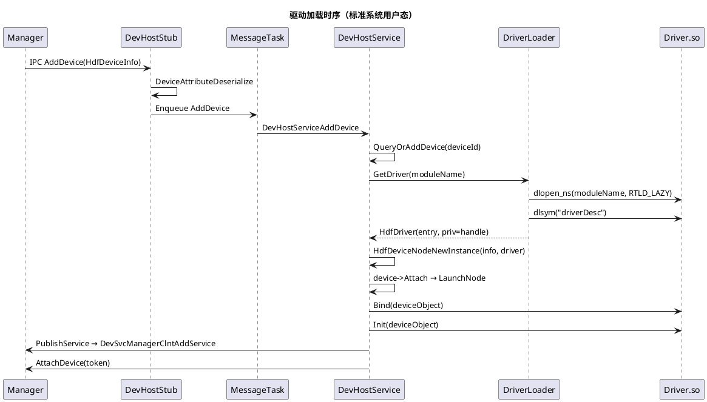

# 技术术语知识

HDF Core 模块核心技术框架和机制的知识定义，涵盖价值认知、原理、使用方式和代码关联。

## 驱动加载机制

### 解决的问题（Problem）
| 子维度 | 内容 |
|---|---|
| 业务痛点 | 不同系统形态（standard/small/mini）与不同内核（Linux/LiteOS-A/LiteOS-M/UniProton/HongMeng）下，驱动注册与加载方式差异大；用户态需进程隔离（dlopen）与符号隔离（namespace），内核态需静态链接段。 |
| 技术目标 | 统一 `HdfDriverEntry` 入口，屏蔽用户态 dlopen 与内核态链接器段的差异；支持按需动态加载（LoadDevice）与 VDI 二级加载；路径安全校验防穿越。 |

### 原理（Principles）
| 子维度 | 内容 |
|---|---|
| 核心机制 | 用户态：`dlopen_ns(moduleName, RTLD_LAZY)` 使用 DLF namespace 隔离符号 → `dlsym(handle, "driverDesc")` 获取 `HdfDriverEntry**` → 取 `*driverEntry`。`HdfDriver` 持有 `entry` 与 `priv=handle`。内核态：编译期 `HDF_INIT` 宏将 `HdfDriverEntry*` 写入链接器段，运行时 `HdfDriverEntryConstruct()` 遍历 `HDF_DRIVER_BEGIN()~END()` 段注册到 `HdfDriverManager`。VDI：`HdfLoadVdi(libName)` → `snprintf_s` 拼路径 → `realpath` 校验必须位于 `HDF_LIBRARY_DIR` 下 → `dlopen_ns` + `dlsym("hdfVdiDesc")` → `CreateVdiInstance`。 |
| 关键流程 | Manager IPC AddDevice → devhost MessageTask → `DevHostServiceAddDevice`（`framework/core/host/src/devhost_service.c:63`）→ `driverLoader->GetDriver(moduleName)` → `HdfDeviceNodeNewInstance` → `device->Attach` → `LaunchNode`（Bind/Init/PublishService/AttachDevice）。 |

### 使用方式（Usage）
| 子维度 | 内容 |
|---|---|
| 核心 API | 驱动侧：`HDF_INIT(g_xxxEntry)`（注册）、`HDF_VDI_INIT(g_xxxVdi)`（VDI 注册）。框架侧：`HdfDriverLoaderGetInstance()`（`framework/core/host/src/hdf_driver_loader.c:78`，返回 `IDriverLoader*`）、`HdfLoadVdi(libName)`（`framework/core/host/src/hdf_load_vdi.c:20`，加载 VDI）、`HdfGetVdiVersion(vdiObj)`、`HdfCloseVdi(vdiObj)`。调用前提：`deviceInfo.moduleName` 与驱动 `HdfDriverEntry.moduleName` 一致；驱动 .so 位于 `/vendor/lib64/` 或 `/vendor/lib/`（aarch64/x86_64 用 lib64，见 `hdf_base.h:128-141`）。资源收尾：`ReclaimDriver` 释放 `HdfDriver` 内存（不 dlclose）；`HdfCloseVdi` 调 `dlclose` 并释放 `HdfVdiObject`。 |

### 代码关联（Code）
| 子维度 | 内容 |
|---|---|
| 核心类 | `struct HdfDriverEntry`（`interfaces/inner_api/host/shared/hdf_device_desc.h:202`）、`struct HdfDriver`（`interfaces/inner_api/host/shared/hdf_driver.h`）、`struct HdfDriverLoader`/`struct DriverLoaderFull`（`framework/core/host/src/hdf_driver_loader.c` / `adapter/uhdf2/host/src/driver_loader_full.c`）、`struct HdfVdiBase`/`HdfVdiObject`（`interfaces/inner_api/host/uhdf/hdf_load_vdi.h:25-35`）。 |
| 核心成员 | `driverDesc` 符号（用户态导出）、`HDF_DRIVER_BEGIN()/END()` 段（内核态）、`hdfVdiDesc` 符号（VDI）、`g_fullLoader` 单例（`driver_loader_full.c:31`）。 |
| 核心方法 | `HdfDriverLoaderGetDriver`（`driver_loader_full.c:33`，用户态）、`HdfDriverLoaderGetDriver`（`hdf_driver_loader.c:40`，内核态）、`HdfDriverEntryConstruct`（`hdf_driver_loader.c:16`，内核段遍历）、`HdfLoadVdi`（`hdf_load_vdi.c:20`）、`HdfDriverLoaderFullReclaimDriver`（`driver_loader_full.c:75`）。 |

### 约束与限制（Constraints）
| 子维度 | 内容 |
|---|---|
| 系统限制 | 用户态驱动 .so 必须位于 `HDF_LIBRARY_DIR`（`/vendor/lib64` 或 `/vendor/lib`，`hdf_base.h:128-141`）；LiteOS 用 `/usr/lib`（`hdf_base.h:98`）。内核态驱动静态链接，不支持 dlopen。 |
| 并发约束 | `HdfDriverLoaderCreate` 用 `static bool isDriverLoaderInit` 保证单例初始化（`hdf_driver_loader.c:66`）；`g_fullLoader` 单例（`driver_loader_full.c:31`）。`ReclaimDriver` 仅 `OsalMemFree(driver)` 不 dlclose，避免卸载仍有引用的 .so。 |
| 安全约束 | VDI 加载 `realpath` 校验路径必须以 `HDF_LIBRARY_DIR` 开头（`hdf_load_vdi.c:35`），防路径穿越；`dlopen_ns` 使用 namespace 隔离驱动符号；普通驱动加载不校验路径（依赖部署目录安全）。 |

## 设备生命周期机制

### 解决的问题（Problem）
| 子维度 | 内容 |
|---|---|
| 业务痛点 | 设备从配置到运行涉及 Manager 分发、Host 加载、驱动 Bind/Init、服务发布、令牌注册多步，任一步失败需正确回滚；动态加载/卸载需保证 IO 并发安全。 |
| 技术目标 | 定义 `LaunchNode`/`UnlaunchNode` 严格序列；失败时按序回滚并释放资源；IO Dispatch 与 Release 通过读写锁互斥。 |

### 原理（Principles）
| 子维度 | 内容 |
|---|---|
| 核心机制 | `LaunchNode`（`framework/core/host/src/hdf_device_node.c:91`）序列：设 `devStatus=LAUNCHED` → `DeviceDriverBind`（仅 PUBLIC/CAPACITY 调 `driverEntry->Bind`，设置 `deviceObject.service`）→ `driverEntry->Init`（硬件初始化）→ `HdfDeviceNodePublishService`（PUBLIC/CAPACITY 调 `DevSvcManagerClntAddService` + 本地 `HdfServiceObserverPublishService`；FRIENDLY/PRIVATE 仅本地）→ `DevmgrServiceClntAttachDevice`（IPC 注册 token）。任一步失败返回对应错误码（`HDF_DEV_ERR_DEV_INIT_FAIL`/`HDF_DEV_ERR_PUBLISH_FAIL`/`HDF_DEV_ERR_ATTACHDEV_FAIL`）。`UnlaunchNode`（`hdf_device_node.c:183`）序列：写锁下 `driverEntry->Release` → 置空 `service` → 解锁 → `RemoveService`（servmgr 注销）→ `DetachDevice`（IPC 通知 Manager）→ `ReclaimDriver`。 |
| 关键流程 | 同驱动加载机制时序图；卸载为反向：Manager IPC DelDevice → MessageTask → `DevHostServiceDelDevice` → `device->Detach` → `UnlaunchNode` → `HdfDeviceNodeFreeInstance` → 若 devNodes 空 `DevHostServiceFreeDevice`。 |

### 使用方式（Usage）
| 子维度 | 内容 |
|---|---|
| 核心 API | 框架内部触发，无独立公开 API。Manager 侧通过 `IDevHostService->AddDevice/DelDevice`（`framework/core/shared/include/devhost_service_if.h`）；客户端动态加载通过 HDI `IDeviceManager->LoadDevice/UnloadDevice`（`interfaces/inner_api/hdi/idevmgr_hdi.h`）。 |

### 代码关联（Code）
| 子维度 | 内容 |
|---|---|
| 核心类 | `struct HdfDeviceNode`（`interfaces/inner_api/host/shared/hdf_device_node.h:34`）、`struct IDeviceNode`（虚表，`hdf_device_node.h:26`）。 |
| 核心成员 | `devStatus`（DEVNODE_NONE/INITED/LAUNCHED）、`servStatus`（bool）、`deviceObject.mutex`（`pthread_rwlock_t`，用户态）。 |
| 核心方法 | `HdfDeviceLaunchNode`（`hdf_device_node.c:91`）、`HdfDeviceUnlaunchNode`（`hdf_device_node.c:183`）、`HdfDeviceNodePublishService`（`hdf_device_node.c:44`）、`HdfDeviceNodePublishPublicService`（`hdf_device_node.c:156`）、`DeviceDriverBind`（`hdf_device_node.c:65`）。 |

### 约束与限制（Constraints）
| 子维度 | 内容 |
|---|---|
| 系统限制 | `Bind` 仅在 `policy == PUBLIC || CAPACITY` 时强制（`hdf_device_node.c:75`）；`Init` 必须实现。`DEVNODE_LAUNCHED` 状态的节点析构必须先 `UnlaunchNode`（`hdf_device_node.c:244`）。 |
| 并发约束 | `Release` 在 `pthread_rwlock_wrlock` 写锁下，调用后立即置空 `service`（`hdf_device_node.c:196-205`）；`DeviceServiceStubDispatch` 在 `pthread_rwlock_rdlock` 读锁下（`device_service_stub.c:37`），读写锁互斥保证 Release 期间无并发 Dispatch。 |
| 安全约束 | 无额外权限校验；权限由 `HdfDeviceInfo.permission` 字段（如 0660）在 vnode 创建时应用。 |

## SBUF 序列化机制

### 解决的问题（Problem）
| 子维度 | 内容 |
|---|---|
| 业务痛点 | Manager-Host（IPC）、客户端-驱动（IPC 或用户-内核直通）、驱动-驱动（本地）多种通信路径需要统一数据序列化；C 接口需跨内核/用户态通用。 |
| 技术目标 | 提供类型自描述的 C 序列化接口；支持 RAW（用户-内核直通）与 IPC（Binder 适配）两种底层实现；wire-format 跨版本稳定。 |

### 原理（Principles）
| 子维度 | 内容 |
|---|---|
| 核心机制 | `HdfSBuf` 持有 `HdfSBufImpl*` 指针，按 `enum HdfSbufType`（`interfaces/inner_api/utils/hdf_sbuf.h:50-55`）实例化不同实现：`SBUF_RAW` 用 `hdf_sbuf_impl_raw.c`（直接内存拷贝，含 padding 对齐）；`SBUF_IPC` 用 `adapter/uhdf2/ipc/` 下的实现（适配 OHOS Parcel）。读写接口类型化（`HdfSbufWriteUint32/ReadUint32/WriteBuffer/ReadBuffer` 等），写时追加 + padding，读时按序消费。 |
| 关键流程 | 客户端 `HdfSbufObtainDefaultSize()` 创建 → `HdfSbufWriteUint16(data, gpio)` 等写入参数 → `service->dispatcher->Dispatch(&service->object, cmdId, data, reply)` → stub 端 `HdfSbufReadUint16` 读出 → 处理 → `HdfSbufWriteUint16(reply, val)` 写回复 → 客户端 `HdfSbufReadUint16(reply, val)` 读结果 → `HdfSbufRecycle(data/reply)` 释放。 |

### 使用方式（Usage）
| 子维度 | 内容 |
|---|---|
| 核心 API | `HdfSbufObtainDefaultSize()`/`HdfSbufObtain(size)`/`HdfSbufRecycle(sbuf)`（生命周期）；`HdfSbufWriteUint8/16/32/64`、`HdfSbufReadUint8/16/32/64`；`HdfSbufWriteBuffer(data, size)`/`HdfSbufReadBuffer(**data, *size)`；`HdfSbufWriteString`/`HdfSbufReadString`；`HdfSbufWriteUnpadBuffer`/`HdfSbufReadUnpadBuffer`（无 padding）。定义于 `interfaces/inner_api/utils/hdf_sbuf.h`。 |

### 代码关联（Code）
| 子维度 | 内容 |
|---|---|
| 核心类 | `struct HdfSBuf`（`interfaces/inner_api/utils/hdf_sbuf.h:41`）、`struct HdfSBufImpl`（`framework/utils/include/hdf_sbuf_impl.h`）、`enum HdfSbufType`（`hdf_sbuf.h:50`）。 |
| 核心成员 | `SBUF_RAW` 实现内部 buffer 与 size/writePos/readPos；`SBUF_IPC` 包装 OHOS `MessageParcel`。 |
| 核心方法 | `HdfSbufObtainDefaultSize`、`HdfSbufRecycle`、各类 `HdfSbufWrite*/Read*`（`framework/utils/src/hdf_sbuf.c` + `hdf_sbuf_impl_raw.c` + `adapter/uhdf2/ipc/`）。 |

### 约束与限制（Constraints）
| 子维度 | 内容 |
|---|---|
| 系统限制 | `HdfSbufWriteBuffer` 最大 512KB（`hdf_sbuf.h:62` 注释）。`SBUF_IPC` 依赖 `libhdf_ipc_adapter.z.so`，仅在标准系统可用；轻量系统用 `SBUF_RAW`。`SBUF_IPC_HW` 为保留位，未启用（改动需架构评审）。 |
| 并发约束 | `HdfSBuf` 实例非线程安全，调用方需保证同一 sbuf 不被并发读写；框架内每个 Dispatch 调用独立 data/reply sbuf。 |
| 安全约束 | 反序列化需校验长度防止越界读；`HdfSbufReadBuffer` 输出指针由实现管理，调用方不应手动释放（`HdfSbufRecycle` 统一回收）。 |

## HCS 配置解析机制

### 解决的问题（Problem）
| 子维度 | 内容 |
|---|---|
| 业务痛点 | 驱动设备拓扑与属性需可配置、可编译期校验、可运行时高效解析；配置与代码解耦，支持多产品差异化。 |
| 技术目标 | `.hcs` 文本经 `hc-gen` 编译为 `.hcb` 二进制 blob，运行时 `GenerateCfgTree` 构造 `DeviceResourceNode` 树，`device_resource_if` 提供类型化访问 API。 |

### 原理（Principles）
| 子维度 | 内容 |
|---|---|
| 核心机制 | 编译期：`hc-gen`（`framework/tools/hc-gen/`）解析 `.hcs` 文本 AST，序列化为 `.hcb` 二进制（节点名、属性名/类型/值、父子关系、引用）。运行期：`HcsDecompile(hcsBlob, offset, &root)`（`framework/utils/src/hcs_parser/hcs_parser.c:22`）调 `GenerateCfgTree`（`hcs_generate_tree.c`）两遍——第一遍 `GetHcsTreeSize` 算内存，第二遍构造 `DeviceResourceNode` 树。`DeviceResourceIface`（`device_resource_if.c:13`）单例绑定 `HcsGetUint32`/`HcsGetString`/`HcsGetNodeByMatchAttr` 等函数到 `DeviceResourceIface` 虚表。 |
| 关键流程 | 部署 `.hcb` → Manager 启动 `HcsGetHostList()` 获取 host 列表 → 分发设备 → devhost `AddDevice` 时 `HcsGetNodeByMatchAttr(HdfGetHcsRootNode(), deviceInfo->deviceMatchAttr)`（`hdf_device_node.c:297`）查找属性节点 → 驱动 `Init` 中 `DeviceResourceGetIfaceInstance(HDF_CONFIG_SOURCE)` → `GetUint32(node, "regBase", &val, 0)` 等读取属性。 |

### 使用方式（Usage）
| 子维度 | 内容 |
|---|---|
| 核心 API | `DeviceResourceGetIfaceInstance(HDF_CONFIG_SOURCE)`（`device_resource_if.c:48`，返回 `DeviceResourceIface*` 单例）；`iface->GetRootNode()`、`iface->GetUint32(node, key, &val, def)`、`iface->GetString(node, key, &val, def)`、`iface->GetNodeByMatchAttr(root, matchAttr)`、`iface->GetChildNode(parent)`、`iface->GetElemNum(node, key)`。`LOSCFG_DRIVERS_HDF_CONFIG_MACRO` 宏模式下属性走 `deviceMatchAttr` 字符串（`hdf_device_desc.h:100-104`）。 |

### 代码关联（Code）
| 子维度 | 内容 |
|---|---|
| 核心类 | `struct DeviceResourceNode`、`struct DeviceResourceIface`（`interfaces/inner_api/utils/device_resource_if.h`）。 |
| 核心成员 | `.hcb` blob、`DeviceResourceNode` 树（含 `name`/`attrData`/`parent`/`child`）。 |
| 核心方法 | `HcsDecompile`（`hcs_parser.c:22`）、`GenerateCfgTree`（`hcs_generate_tree.c`）、`DeviceResourceGetIfaceInstance`（`device_resource_if.c:48`）、`HcsGetNodeByMatchAttr`/`HcsGetUint32`/`HcsGetString`（`hcs_tree_if.c`）。 |

### 约束与限制（Constraints）
| 子维度 | 内容 |
|---|---|
| 系统限制 | `hc-gen` 语法扩展需同步工具链（`framework/tools/hc-gen/`）；新增 HCS 语法必须先扩展 hc-gen 并回归历史 `.hcs` 编译。`HDF_CONFIG_SOURCE` 是当前唯一支持的 `DeviceResourceType`（`device_resource_if.c:42`）。 |
| 并发约束 | `DeviceResourceIface` 为单例（`device_resource_if.c:50-56`），构造期单线程；运行时只读，无需锁。 |
| 安全约束 | 无；配置数据在 `.hcb` 中只读。 |

## 对象工厂机制

### 解决的问题（Problem）
| 子维度 | 内容 |
|---|---|
| 业务痛点 | 同一框架代码需在不同进程环境（Manager/Host/kernel）实例化不同实现（如 `DEVMGR_SERVICE` 在 Manager 创建 Stub、在 Host 创建 Proxy）；需统一创建入口避免散落 new。 |
| 技术目标 | 按 `objectId` 查 Creator 表创建对象，不同环境注册不同表，框架代码用同一 `HdfObjectManagerGetObject(id)` 获取环境适配的实现。 |

### 原理（Principles）
| 子维度 | 内容 |
|---|---|
| 核心机制 | `HdfObjectManagerGetCreators(objectId)`（`framework/core/shared/include/hdf_object_manager.h:36`）返回 `HdfObjectCreator{Create, Release}` 函数对。8 类 objectId（`hdf_object_manager.h:18-29`）：DEVMGR_SERVICE/DEVSVC_MANAGER/DEVHOST_SERVICE/DRIVER_INSTALLER/DRIVER_LOADER/DEVICE/DEVICE_TOKEN/DEVICE_SERVICE/REMOTE_SERVICE。Manager 进程在 `adapter/uhdf2/manager/devmgr_object_config.c` 注册表（DEVMGR_SERVICE→`DevmgrServiceStubCreate` 等）；Host 进程在 `adapter/uhdf2/host/devhost_object_config.c` 注册表（DEVMGR_SERVICE→`DevmgrServiceProxyCreate`、DEVHOST_SERVICE→`DevHostServiceStubCreate` 等）。 |
| 关键流程 | `HdfObjectManagerGetObject(HDF_OBJECT_ID_DEVICE_SERVICE)`（`hdf_device_node.c:272`）→ 查当前环境 Creator 表 → `Create()` 返回 `HdfObject*` → 调用方转具体类型。释放经 `HdfObjectManagerFreeObject(&obj)`（`hdf_device_node.c:310`）。 |

### 使用方式（Usage）
| 子维度 | 内容 |
|---|---|
| 核心 API | `HdfObjectManagerGetObject(objectId)`（创建）、`HdfObjectManagerFreeObject(object)`（释放）、`HdfObjectManagerGetCreators(objectId)`（获取 Creator 表）。新增对象类型需在 `hdf_object_manager.h` 枚举与各环境 `*_object_config.c` 注册。 |

### 代码关联（Code）
| 子维度 | 内容 |
|---|---|
| 核心类 | `struct HdfObjectCreator`（`hdf_object_manager.h:31-34`）、`enum HDF_OBJECT_ID_*`（`hdf_object_manager.h:18-29`）。 |
| 核心成员 | 各环境 `g_creators[]` 静态数组（`devmgr_object_config.c` / `devhost_object_config.c` / `devlite_object_config.c`）。 |
| 核心方法 | `HdfObjectManagerGetObject`/`FreeObject`/`GetCreators`（`framework/core/shared/src/hdf_object_manager.c`）。 |

### 约束与限制（Constraints）
| 子维度 | 内容 |
|---|---|
| 系统限制 | 新增 objectId 需在 `HDF_OBJECT_ID_MAX` 前插入，且所有环境注册表同步更新，否则某环境 `GetCreators` 返回 NULL 导致创建失败。 |
| 并发约束 | Creator 表为静态只读，无需锁；`Create` 返回的实例对象自身需管理并发（如 `DevHostServiceStub` 用 `hostSvcMutex`）。 |
| 安全约束 | 无。 |

## 电源管理机制

### 解决的问题（Problem）
| 子维度 | 内容 |
|---|---|
| 业务痛点 | 系统休眠/唤醒需按依赖顺序通知各驱动；部分驱动需 wake lock 持有异步保活；休眠失败不能阻断其它设备。 |
| 技术目标 | 提供两种 PM 模式（SYS_CTRL 事件推送 / DYNAMIC_CTRL 引用计数）；唤醒反向遍历（后设备先醒），休眠正向遍历（先设备先睡）；异步 PM 经专用任务队列。 |

### 原理（Principles）
| 子维度 | 内容 |
|---|---|
| 核心机制 | 系统事件经 `OsalSysEvent`（`HDF_POWER_EVENT` 等）→ Manager `PowerStateChange` → 各 Host `PmNotify`（`framework/core/host/src/devhost_service.c:199`）→ 各 HdfDevice `ApplyDevicesPowerState`（`devhost_service.c:167`）→ 各 devNode `powerToken` 的 `PowerStateChange`（`power_state_token.c`）。SYS_CTRL 模式直接调 `listener->Suspend/Resume/Idle`；DYNAMIC_CTRL 模式用 `HdfSRef` 引用计数（`AcquireWakeLock` 初次→Resume，`ReleaseWakeLock` 末次→Suspend）。异步 PM：`HdfPmAcquireDeviceAsync`/`ReleaseDeviceAsync`（`interfaces/inner_api/host/shared/hdf_pm.h:42-43`）→ `HdfPmTaskPut`（`framework/core/host/src/hdf_power_manager.c:72`）入队 `PmTaskQueue` 专用线程处理。 |
| 关键流程 | 系统休眠事件 → Manager 正向遍历 hosts → devhost 正向遍历 devices → 正向遍历 devNodes → `PowerStateChange(SUSPEND)` → `listener->Suspend(deviceObject)`。唤醒反向。 |

### 使用方式（Usage）
| 子维度 | 内容 |
|---|---|
| 核心 API | 驱动侧：`HdfPmRegisterPowerListener(deviceObject, &listener)`（注册 `IPowerEventListener`，`hdf_pm.h:37`）、`HdfPmUnregisterPowerListener`、`HdfPmAcquireDevice`/`HdfPmReleaseDevice`（DYNAMIC_CTRL wake lock）、`HdfPmAcquireDeviceAsync`/`HdfPmReleaseDeviceAsync`（异步）、`HdfPmSetMode(deviceObject, HDF_POWER_SYS_CTRL/DYNAMIC_CTRL)`。框架侧：`HdfPowerManagerInit`（`hdf_power_manager.c:98`，注册 `DevMgrPmRegister` + 初始化 PM 任务队列）。 |

### 代码关联（Code）
| 子维度 | 内容 |
|---|---|
| 核心类 | `struct IPowerEventListener`（`interfaces/inner_api/host/shared/hdf_pm.h:28-35`）、`enum PowerManagementMode`（`hdf_pm.h:14-18`）、`struct PowerStateToken`（`framework/core/host/src/power_state_token.c`）、`struct PmTaskQueue`（`hdf_power_manager.c:17`）。 |
| 核心成员 | `HdfDeviceNode.powerToken`（`hdf_device_node.h:37`）、`HdfPmRequest.task`/`token`/`pmType`（`hdf_power_manager.c`）。 |
| 核心方法 | `HdfDeviceNodeAddPowerStateListener`（`hdf_device_node.c:130`）、`PowerStateChange`（`power_state_token.c`）、`DevHostServicePmNotify`（`devhost_service.c:199`）、`ApplyDevicesPowerState`（`devhost_service.c:167`）、`HdfPmTaskPut`（`hdf_power_manager.c:72`）、`IsPowerWakeState`（`framework/core/shared/include/hdf_power_state.h`）。 |

### 约束与限制（Constraints）
| 子维度 | 内容 |
|---|---|
| 系统限制 | `HdfPmAcquireDeviceAsync`/`ReleaseDeviceAsync` 不支持 `__LITEOS_M__`（`hdf_pm.h:41`）。PM 任务队列单线程串行处理，大量异步请求会排队。 |
| 并发约束 | 电源遍历期间单个设备失败不阻断（`devhost_service.c:172` 注释"ignore devices that fail"）；`PowerStateToken` 引用计数操作需原子。 |
| 安全约束 | 无额外权限；PM 事件由系统 `OsalSysEvent` 推送，驱动注册后被动接收。 |

## 平台设备 IO 调用机制

### 解决的问题（Problem）
| 子维度 | 内容 |
|---|---|
| 业务痛点 | 同一平台外设（如 GPIO）需同时支持内核态调用（驱动内直接调）与用户态调用（应用经 IPC）；两套调用路径需共享同一设备核心实现。 |
| 技术目标 | 三层结构（core/if/if_u）：`xxx_core.c` 核心抽象 + `PlatformManager` 管理；`xxx_if.c` 内核态直接调 core；`xxx_if_u.c` 用户态经 `HdfIoServiceBind` + SBUF + Dispatch。 |

### 原理（Principles）
| 子维度 | 内容 |
|---|---|
| 核心机制 | 内核态：`xxx_if.c` 中 `GpioRead(gpio, val)` 直接调 `GpioCntlrGet(gpio)` + `cntlr->ops->Read(gpio)`，无 IPC 开销。用户态：`xxx_if_u.c` 中 `GpioRead(gpio, val)`（`framework/support/platform/src/gpio/gpio_if_u.c:46`）→ `GpioManagerServiceGet()`（`HdfIoServiceBind("HDF_PLATFORM_GPIO_MANAGER")`，缓存静态 service）→ `HdfSbufObtainDefaultSize` 创建 data/reply → `HdfSbufWriteUint16(data, gpio)` → `service->dispatcher->Dispatch(&service->object, GPIO_IO_READ, data, reply)`（经 IPC 到 devhost `DeviceServiceStub`）→ 驱动 `Dispatch` 处理 → `HdfSbufReadUint16(reply, val)`。事件监听经 `PlatformUserListenerManager` + `HdfDeviceRegisterEventListener`。 |
| 关键流程 | 用户态：应用调 `GpioRead` → if_u 序列化 → IPC Dispatch → devhost `DeviceServiceStubDispatch`（读锁）→ 驱动 `ioService->Dispatch` → core 层操作硬件 → 回 reply → if_u 反序列化返回。 |

### 使用方式（Usage）
| 子维度 | 内容 |
|---|---|
| 核心 API | 用户态（`xxx_if_u.c`）：`GpioRead/Write/SetDir/GetDir/SetIrq/UnsetIrq` 等，经 `HdfIoServiceBind("HDF_PLATFORM_XXX_MANAGER")`。内核态（`xxx_if.c`）：同名 API 直接调 `xxx_core.c`。事件：`HdfDeviceRegisterEventListener(service, listener)` / `HdfDeviceUnregisterEventListener`。设备管理：`PlatformManagerCreate(name, &mgr)`（`framework/support/platform/src/fwk/platform_manager.c:69`）。 |

### 代码关联（Code）
| 子维度 | 内容 |
|---|---|
| 核心类 | `struct HdfIoService`（`interfaces/inner_api/core/hdf_io_service_if.h:108`）、`struct HdfIoDispatcher`（`hdf_io_service_if.h:96`）、`struct PlatformManager`/`PlatformDevice`（`framework/support/platform/include/fwk/platform_manager.h`）。 |
| 核心成员 | `HdfIoService.dispatcher->Dispatch`、`PlatformManager.device.spin`（`platform_manager.c:19` 自旋锁保护设备列表）。 |
| 核心方法 | `HdfIoServiceBind`/`Recycle`（`hdf_io_service_if.h:223/232`）、`HdfDeviceRegisterEventListener`（`hdf_io_service_if.h:245`）、`PlatformManagerCreate`（`platform_manager.c:69`）、各 `xxx_if_u.c` 的 `XxxManagerServiceGet` 静态缓存。 |

### 约束与限制（Constraints）
| 子维度 | 内容 |
|---|---|
| 系统限制 | 用户态 API 依赖 IPC 往返，性能低于内核态直接调用；高频场景应考虑内核态或异步事件。`HdfIoServiceBind` 服务名需与驱动 `servName`（HCS `serviceName`）完全匹配（如 `HDF_PLATFORM_GPIO_MANAGER`）。 |
| 并发约束 | `PlatformManager` 设备列表用 `OsalSpinLockIrqSave` 保护（`platform_manager.c:17-25`）；`DeviceServiceStubDispatch` 用读锁；用户态 `HdfIoService` 静态缓存单例，初次绑定后复用。 |
| 安全约束 | 用户态调用经 IPC 到 devhost，受 devhost 进程权限与 SELinux 策略约束；内核态调用无额外权限检查。 |

## 异步消息机制

### 解决的问题（Problem）
| 子维度 | 内容 |
|---|---|
| 业务痛点 | Manager 与 devhost 主线程不能阻塞在单次 IPC 上；AddDevice/DelDevice、Host 死亡清理、PM 异步请求需排队串行处理避免 IPC 死锁。 |
| 技术目标 | 提供 `HdfMessageLooper`（消息队列 + 循环线程）+ `HdfMessageTask`（绑定 handler 的消息派发），支持同步/异步/延迟消息。 |

### 原理（Principles）
| 子维度 | 内容 |
|---|---|
| 核心机制 | `HdfMessageLooper`（`framework/utils/include/hdf_message_looper.h:20-25`）持有 `HdfMessageQueue messageQueue`，`Start()` 循环取消息调 `DispatchMessage`。`HdfMessageTask`（`hdf_message_task.h:25-32`）绑定 looper 与 `IHdfMessageHandler`，提供 `SendMessage(msg, sync)`/`SendMessageLater(msg, delay)`/`RemoveMessage(msg)`/`DispatchMessage(msg)`。Manager `DevmgrServiceFull` 与 devhost `DevHostServiceFull` 均继承 `HdfMessageTask`，实现 `IHdfMessageHandler->Dispatch` 分发不同消息类型（如 Host 死亡清理为独立 `MessageTask`）。 |
| 关键流程 | IPC Stub 收到命令 → `Enqueue` 消息到 `messageQueue` → looper 线程取出 → `MessageTask->DispatchMessage` → `handler->Dispatch(task, msg)` 按类型处理。Host 死亡：`HdfDeathRecipient` 回调 → 创建 `MessageTask` 入队 → looper 线程异步执行 `CleanupDiedHostResources`。 |

### 使用方式（Usage）
| 子维度 | 内容 |
|---|---|
| 核心 API | `HdfMessageLooperConstruct(looper)`（`framework/utils/src/hdf_message_looper.c`）、`HdfMessageTaskConstruct(inst, looper, handler)`（`framework/utils/src/hdf_message_task.c`）、`task->SendMessage(task, msg, sync)`、`task->SendMessageLater(task, msg, delay)`、`looper->Start(looper)`/`Stop(looper)`（`MESSAGE_STOP_LOOP = -1`）。 |

### 代码关联（Code）
| 子维度 | 内容 |
|---|---|
| 核心类 | `struct HdfMessageLooper`（`hdf_message_looper.h:20`）、`struct HdfMessageTask`（`hdf_message_task.h:25`）、`struct IHdfMessageHandler`（`hdf_message_task.h:21`）。 |
| 核心成员 | `HdfMessageLooper.messageQueue`、`isRunning`；`HdfMessageTask.messageQueue`、`messageHandler`。 |
| 核心方法 | `HdfMessageLooperConstruct`（`framework/utils/src/hdf_message_looper.c`）、`HdfMessageTaskConstruct`（`framework/utils/src/hdf_message_task.c`）、`DevmgrServiceFull`/`DevHostServiceFull` 的 `MessageTask` 集成（`adapter/uhdf2/manager/`、`adapter/uhdf2/host/`）。 |

### 约束与限制（Constraints）
| 子维度 | 内容 |
|---|---|
| 系统限制 | 消息循环单线程串行，长耗时处理会阻塞后续消息；`MESSAGE_STOP_LOOP(-1)` 为停止信号。`SendMessageLater` 延迟精度依赖 looper 实现。 |
| 并发约束 | 消息队列内部线程安全（`OsalMsgQueue`）；handler->Dispatch 在 looper 线程串行执行，无需额外锁（但访问共享数据仍需外部锁）。 |
| 安全约束 | 无。 |
